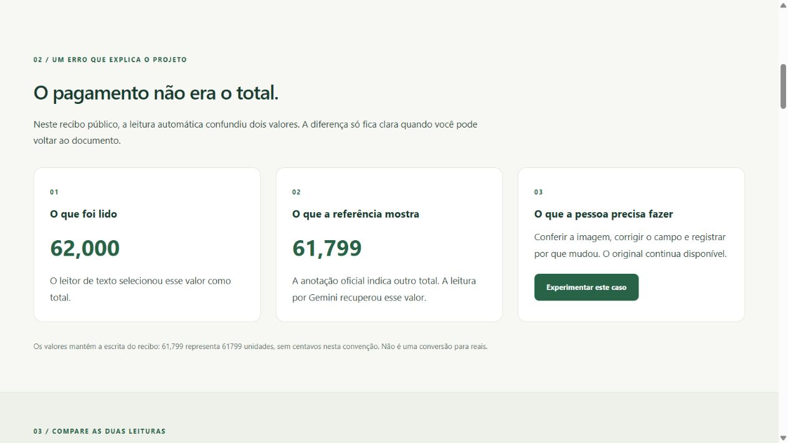

# ReceiptTrace

**Read a receipt, check the values and preserve what changed.**

An applied AI engineering portfolio project developed by Luiz. It connects public data, OCR/Gemini comparison, monetary rules, an API and a Portuguese/English interface.

[Português](README.md) · [Case study](docs/case-study.md) · [Engineering decisions](docs/architecture.md) · [Documentation](docs/README.md)

## 1. The problem: a completed reading can be wrong

People organizing receipts need to check amounts before entering them elsewhere. One public receipt made this concrete: OCR selected **`62,000`** as the total, while the official reference gives **`61,799`**. Gemini recovered the reference value.

Values preserve the document notation: here, `61,799` means `61799` whole units. No currency conversion is applied. [Inspect the preserved responses](docs/reports/evidence/).

The proposed use case is an administrative team identifying uncertainty, checking the image and recording corrections. Labor savings have not been measured in a real operation.

## 2. The solution: automatic reading with reviewable results

**Image → reading → checking → correction with a reason → export.**

- Start with the guided case without a file or API key. Its saved reading is identified as a study example.
- Upload PNG/JPG to run local OCR when uploads are enabled.
- Check five fields beside the image. Conflicting values stay blank; missing components do not become zero.
- Download a CSV table for spreadsheets or JSON with the full session record.

The browser test is temporary. Persistent SQLite history is available for local review of saved examples. Visitor corrections never change study metrics.



## 3. What was measured

OCR and Gemini processed the same **20 public CORD v2 receipts**, selected with seed 42. This supports further investigation, not claims about unseen documents.

| Question | Available evidence |
| --- | --- |
| Did AI recover more correct totals? | OCR: **14 of 19**; Gemini: **19 of 19**. Five additional totals recovered. |
| Other fields? | Subtotal: 9/14 → 14/14. Tax: 7/11 → 11/11. Denominators depend on valid references. |
| Processing time? | Median: 1.04 s for OCR and 8.33 s for Gemini, with different timing scopes. |
| API cost? | Estimated US$ 0 under the confirmed Free Tier for that batch; excludes computing and hosting. |
| Were calculations certified? | No. All 76 arithmetic checks lacked required components. |

This training sample was already used during development; no held-out test was run. Item accuracy is unmeasured. Fiscal validation, payment approval and productivity gains are not established.

[Report and limitations](docs/reports/gemini-development-20.md) · [Field comparison](docs/reports/ocr-vs-gemini-development-20.json) · [Evaluation protocol](docs/evaluation.md)

## 4. What the implementation demonstrates

| Decision | Why | Evidence |
| --- | --- | --- |
| Separate extraction and evaluation | Extractors receive images; expected answers are used separately. | [Evaluation](docs/evaluation.md) |
| Preserve text and use Decimal | Interpret separators explicitly and avoid floating-point rounding. | [Domain rules](docs/domain.md) |
| Use transactions and expected revisions | Preserve the original and prevent silent review overwrites. | [Local review](docs/review.md) |
| Run OCR in a separate process | Bound duration and concurrency without saving uploaded material. | [Temporary uploads](docs/uploads.md) |
| Serve UI and API from one origin | Keep execution reproducible using FastAPI without a frontend build. | [Web architecture](docs/architecture-web.md) |
| Test failures and retain evidence | Check invalid inputs, conflicts, timeouts and artifact integrity. | [Quality and reproduction](docs/quality.md) |

## 5. Try it locally

Requirements: Python 3.14 and uv. From the project directory:

```powershell
uv sync --locked --extra web --extra ocr
uv run --no-sync receipttrace serve --uploads
```

Open [the local demonstration](http://127.0.0.1:8000). The ready example requires no new inference. Personal-image testing uses local OCR without a Gemini key. [Interface guide](docs/web.md).

For the ready example alone, install the `web` extra and start `receipttrace serve --read-only`. Stateless field checks and downloads remain available without exposing local review storage. Hosted deployment remains pending.

## 6. Explore the repository

| Directory | Contents |
| --- | --- |
| `src/receipttrace/` | Domain rules, extractors, evaluation, review and API. |
| `src/receipttrace/static/` | Bilingual interface and HTTP clients. |
| `src/receipttrace/webdata/` | Verified public resources required by the installed demonstration. |
| `tests/` | Domain, contract, failure and input-boundary tests. |
| `docs/reports/` | Published results, data provenance and reproducible evidence. |
| `examples/` | Sample configurations and requests without credentials. |

Start with the [documentation index](docs/README.md). Dependency versions are locked in `uv.lock`; see the [development guide](docs/development.md) for local and CI checks. Detailed technical guides are currently in Portuguese.

Data comes from [CORD v2](https://huggingface.co/datasets/naver-clova-ix/cord-v2), by the [CORD authors](https://github.com/clovaai/cord), under CC BY 4.0. Attribution accompanies the three distributed images; data licensing is separate from code licensing. Credentials, the complete dataset and local databases stay outside Git.

AI assisted development. The maintainer remains responsible for understanding, reviewing and verifying the result. See [security limitations](docs/security.md).
