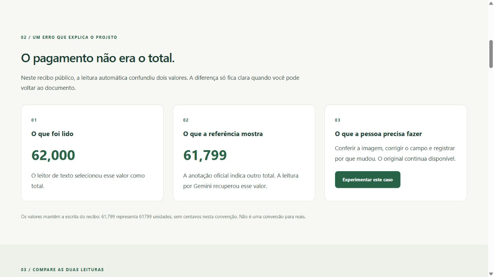
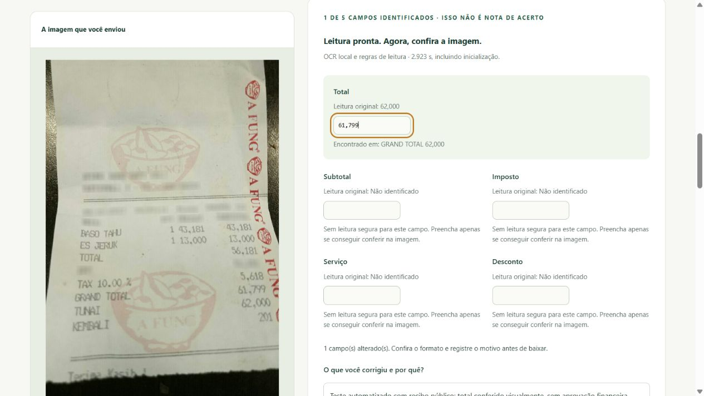

# ReceiptTrace

Transforma imagens de recibos em dados estruturados e permite conferir a origem de cada resultado.

[English](README.en.md)

## O problema e a proposta

Lançar informações de recibos manualmente exige atenção: um valor de pagamento pode ser confundido com o total, e um campo ilegível pode passar despercebido. O ReceiptTrace explora como apoiar essa tarefa com extração automática, validação e evidências para revisão.

O projeto compara duas abordagens nos mesmos documentos: OCR, que reconhece o texto e aplica regras, e Gemini, que interpreta a imagem para extrair os campos. A proposta é avaliar qualidade, tempo e custo antes de escolher uma solução. A redução de trabalho manual ainda não foi medida em uma operação real.

## Para quem e quais decisões o projeto apoia

O cenário proposto é uma equipe administrativa ou financeira que organiza comprovantes e precisa conferir os valores antes de usá-los em outro processo. A pessoa revisora precisa localizar dúvidas; a gestão precisa avaliar se a qualidade da extração justifica seu tempo e custo. Esse é um cenário de uso, ainda sem implantação em uma empresa.

| Pergunta de negócio | Resposta disponível |
|---|---|
| A IA recupera mais valores corretos que o OCR? | Recuperou cinco totais adicionais nesta amostra. |
| Quanto tempo leva? | Mediana de 8,33 s com IA e 1,04 s com OCR, com escopos de medição diferentes. |
| Quanto custou a API neste lote? | US$ 0 estimados sob a configuração gratuita usada; não é custo operacional completo. |
| Podemos dispensar a conferência humana? | Não há evidência para isso. Itens e consistência aritmética não foram certificados. |
| Podemos conferir a origem de um resultado? | Sim, por meio das respostas, configurações e hashes preservados. O histórico de correções já está implementado localmente, com responsável e motivo declarados. |
| Já foi comprovada economia de trabalho? | Não. É necessário medir digitação, conferência e correção em uma avaliação própria. |

[Problema, perguntas de negócio e próximos indicadores](docs/business-case.md).

## Resultados em 20 recibos reais

Na amostra de desenvolvimento do CORD v2, o Gemini recuperou corretamente cinco totais que o OCR havia errado ou deixado sem resposta.

| Informação | OCR local: acertos | Gemini: acertos |
|---|---:|---:|
| Total do recibo | 14 de 19 | 19 de 19 |
| Subtotal | 9 de 14 | 14 de 14 |
| Imposto | 7 de 11 | 11 de 11 |

Os denominadores variam porque nem todo recibo tem todos os campos anotados para conferência. Os dois métodos processaram os mesmos 20 documentos.

O Gemini concluiu as 20 extrações sem falha técnica. O tempo mediano por recibo foi de **8,33 segundos**; o percentil 95 foi de **22,52 segundos**. O OCR foi mais rápido: mediana de 1,04 segundo. Os tempos incluem etapas diferentes, explicadas no relatório.

O custo estimado conhecido da API foi de **US$ 0**, sob a configuração Free Tier confirmada, sem faturamento ativado. Esse valor não é uma fatura e não inclui computação ou hospedagem.

**Limites do resultado:** esta é uma amostra pequena de treino, já usada no desenvolvimento. Não comprova desempenho em novos documentos. A qualidade dos itens ainda não foi medida. As 76 verificações aritméticas foram puladas por falta dos componentes exigidos; portanto, os acertos de extração não certificam a consistência financeira dos recibos.

[Relatório explicado e instruções de reprodução](docs/reports/gemini-development-20.md) · [Resultados por documento](docs/reports/gemini-development-20.json) · [Comparação detalhada](docs/reports/ocr-vs-gemini-development-20.json)

## O que já funciona

- Aquisição dos dados públicos e verificação de integridade dos arquivos.
- Extração por OCR local e por Gemini 3.5 Flash-Lite.
- Validação do formato, preservação do texto original e regras monetárias explícitas.
- Avaliação independente, com falhas e campos sem resposta incluídos nos resultados.
- Preservação de respostas, configurações e hashes para auditoria.
- Revisão local com valores originais preservados, correções e conclusão registradas em histórico.

A aplicação possui interface bilíngue e API, além dos comandos locais. A revisão visual edita cinco campos de totais e preserva o histórico. A publicação em hospedagem continua pendente. O fluxo planejado é: imagem → extração → validação → revisão → exportação.

## Abrir a demonstração local



Interface em PT-BR; também disponível em inglês.

```powershell
uv sync --locked --extra web --extra ocr
uv run --no-sync receipttrace serve --uploads
```

Abra [http://127.0.0.1:8000](http://127.0.0.1:8000). A interface permite testar uma imagem própria com OCR local e explorar três exemplos públicos com comparação OCR/IA. Oferece conferência e exportação em PT-BR e inglês, sem chave de API e sem baixar o dataset completo. [Guia da aplicação e da API](docs/web.md).

## Como conferir os resultados sem usar uma API

Requisitos: Python 3.14 e uv. Na raiz do projeto:

```powershell
uv sync --locked
uv run receipttrace prepare-cord
uv run receipttrace verify-sample
uv run receipttrace evaluate-extraction --sample data/processed/cord-inspection --run docs/reports/evidence/gemini-development-20 --output runs/gemini-replay.json
```

A preparação baixa aproximadamente 490 MB e seleciona os 20 documentos com semente 42. Se a amostra já existir, execute apenas a verificação e a avaliação. Use um arquivo de saída novo. Essa avaliação usa respostas salvas: não exige chave e não envia imagens ao provedor.

Para extrair novas respostas, siga o [guia de configuração do Gemini](docs/gemini.md). A chave fica no arquivo `.env`, fora do Git. O [OCR local](docs/ocr.md) pode ser executado sem API externa. As versões das dependências estão fixadas em `uv.lock`.

## Como revisar um resultado

O [guia de revisão](docs/review.md) explica como abrir uma extração salva, corrigir campos e registrar a conclusão. As ações são enviadas por arquivos JSON; não é necessária chave de API. Cada evento registra responsável, motivo, data e valores antes/depois em um banco SQLite local. Uma alteração posterior reabre a revisão.

O estado de revisão é separado do sucesso da extração e das verificações aritméticas. Concluir a revisão não aprova pagamento nem cálculos que ficaram sem verificação. A identidade do responsável é declarada localmente, sem autenticação.

## Como o projeto pode ser auditado

Cada execução registra a imagem de origem, a configuração, o prompt, a resposta, o tempo e os hashes dos arquivos. O avaliador confere a integridade e compara os valores extraídos com as anotações oficiais. O extrator recebe apenas imagens; as respostas esperadas são usadas separadamente na avaliação.

Os resultados salvos permitem recalcular as métricas sem novas chamadas de IA. Uma nova inferência pode produzir respostas diferentes. O [relatório](docs/reports/gemini-development-20.md) descreve as condições da medição e as diferenças de metadados na reprodução do OCR histórico.

## Documentação do produto e da implementação

- [Problema e perguntas de negócio](docs/business-case.md)
- [Jornada e apresentação do produto](docs/presentation.md)
- [Escopo e critérios de entrega](docs/scope.md)
- [Arquitetura e responsabilidades](docs/architecture.md)
- [Dados e método de avaliação](docs/evaluation.md)
- [Aplicação web e API](docs/web.md)
- [Teste com seu próprio recibo](docs/uploads.md)
- [Segurança, erros e limites de publicação](docs/security.md)
- [Decisão da arquitetura web](docs/architecture-web.md)
- [Revisão e histórico de correções](docs/review.md)
- [Campos, números e verificações aritméticas](docs/domain.md)
- [Ambiente e verificações de qualidade](docs/development.md)
- [Etapas de implementação](docs/roadmap.md)
- [Padrões de contribuição e escrita](CONTRIBUTING.md)

## Dados, atribuição e transparência

Os recibos vêm do [CORD v2 público](https://huggingface.co/datasets/naver-clova-ix/cord-v2), dos [autores do CORD](https://github.com/clovaai/cord), sob CC BY 4.0. A demonstração inclui três imagens originais do CORD, com atribuição, além dos resultados derivados. O dataset completo e os arquivos de gabarito permanecem fora do repositório. A licença dos dados é independente da licença do código.

O projeto ainda não comprova suporte a documentos fiscais brasileiros nem conferência entre nota e pedido. Houve assistência de IA no desenvolvimento e na documentação. A responsabilidade por compreender, revisar e verificar as entregas é do mantenedor.

## Teste com um recibo próprio

A interface permite enviar PNG ou JPG, acompanhar o OCR local, conferir cinco campos e baixar o resultado com original, correções e registro da sessão. Não exige chave de API. O envio precisa ser habilitado com `--uploads` e requer o extra `ocr`. A aplicação processa imagem e texto em memória, sem gravá-los no servidor.

Os testes enviados por visitantes ficam separados dos indicadores do estudo. A conferência humana continua necessária. Veja o [guia de uso, proteção e limites](docs/uploads.md).


