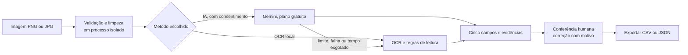

# ReceiptTrace

[](https://github.com/luizznelson/receipttrace/actions/workflows/ci.yml)

**Leia um recibo, confira os valores e preserve o que foi corrigido.**

Projeto de portfólio de engenharia de IA aplicada, desenvolvido por Luiz. Conecta dados públicos, comparação de OCR e Gemini, regras monetárias, uma API e uma interface em português e inglês.

**▶ [Ver a demonstração ao vivo](https://receipttrace.onrender.com)** (serviço gratuito: a primeira visita pode levar cerca de 1 minuto para acordar)

[English](README.en.md) · [Entenda o caso](docs/case-study.md) · [Decisões de engenharia](docs/architecture.md) · [Documentação](docs/README.md)

## Em 1 minuto

| | |
| --- | --- |
| **Problema** | Uma leitura automática de recibo pode terminar sem erro e ainda assim trazer o valor errado. |
| **O que construí** | API FastAPI e interface em português e inglês que leem o recibo por IA (Gemini) ou OCR local, mostram a evidência ao lado da imagem e registram cada correção com motivo. |
| **Resultado medido** | Total correto em 14 de 19 recibos com OCR e 19 de 19 com Gemini, em 20 recibos públicos usados no desenvolvimento. Não é um teste independente. |
| **Habilidades que o projeto mostra** | Python 3.14 tipado, FastAPI, regras monetárias com Decimal, integração com LLM (consentimento, cotas, fallback), segurança no envio de arquivos, testes Python e JavaScript, CI, Docker e implantação, e avaliação com limites declarados. |
| **Onde começar** | [Demonstração](https://receipttrace.onrender.com) · [Estudo de caso](docs/case-study.md) · [Decisões de engenharia](docs/architecture.md) · [Como verificar](docs/quality.md) |

## 1. O problema: uma leitura concluída pode estar errada

Quem organiza comprovantes precisa conferir os valores antes de lançá-los. Neste projeto, um recibo público tornou o risco concreto: o OCR selecionou **`62,000`** como total, enquanto a referência oficial indica **`61,799`**. O Gemini recuperou o valor da referência.

Os valores mantêm a escrita do documento: nessa convenção, `61,799` significa `61799` unidades inteiras. Não é uma conversão para reais. [Veja as respostas preservadas dos dois métodos](docs/reports/evidence/).

O objetivo é ajudar uma equipe administrativa a localizar dúvidas, conferir a imagem e registrar correções. Economia de trabalho ainda não foi medida em uma operação real.

## 2. A solução: automatizar a leitura e tornar a conferência possível

**Imagem → leitura → conferência → correção com motivo → exportação.**

- Comece pelo caso guiado, sem arquivo ou chave de API. A leitura salva é identificada como exemplo do estudo.
- Envie uma imagem PNG/JPG e escolha a leitura: **IA (Gemini, plano gratuito)**, com consentimento a cada envio e retorno automático ao OCR local se a IA falhar, ou **OCR local**.
- Confira os cinco campos ao lado da imagem. Valores conflitantes ficam vazios e componentes ausentes não viram zero.
- Baixe uma tabela CSV para abrir em planilha ou um JSON com o registro completo da sessão.

O teste da aba é temporário. O histórico persistente com SQLite está disponível na revisão local dos exemplos. As correções de visitantes não alteram os indicadores do estudo.




## 3. O que foi medido

OCR e Gemini processaram os mesmos **20 recibos públicos do CORD v2**, selecionados com semente 42. O resultado apoia continuar o experimento; não comprova desempenho em documentos novos.

| Pergunta | Evidência disponível |
| --- | --- |
| A IA recuperou mais totais corretos? | OCR: **14 de 19**; Gemini: **19 de 19**. Cinco totais adicionais recuperados. |
| E os outros campos? | Subtotal: 9/14 → 14/14. Imposto: 7/11 → 11/11. Os denominadores dependem das referências válidas. |
| Quanto demorou? | Mediana: 1,04 s com OCR e 8,33 s com Gemini, com escopos de medição diferentes. |
| Quanto custou a API? | US$ 0 estimados no Free Tier confirmado para aquele lote; não inclui computação nem hospedagem. |
| As contas foram certificadas? | Não. As 76 verificações aritméticas ficaram sem componentes suficientes. |

Esta é uma amostra de treino já utilizada no desenvolvimento, sem teste reservado. Itens não tiveram qualidade avaliada. Não há validação fiscal brasileira, aprovação de pagamento ou comprovação de produtividade.

[Relatório com método e limites](docs/reports/gemini-development-20.md) · [Comparação por campo](docs/reports/ocr-vs-gemini-development-20.json) · [Protocolo de avaliação](docs/evaluation.md)

## 4. O que a implementação demonstra

| Decisão | Por que foi feita | Onde conferir |
| --- | --- | --- |
| Separar extração de avaliação | O extrator recebe imagens; as respostas esperadas são usadas separadamente. | [Avaliação](docs/evaluation.md) |
| Preservar texto e usar Decimal | Interpretar separadores explicitamente e evitar arredondamentos de ponto flutuante. | [Domínio e números](docs/domain.md) |
| Usar transações e versão esperada | Preservar o original e impedir sobrescrita silenciosa de uma revisão. | [Revisão local](docs/review.md) |
| Executar OCR em processo separado | Limitar duração e concorrência, sem salvar o material enviado. | [Envio temporário](docs/uploads.md) |
| Oferecer IA só com consentimento, cotas e fallback | A imagem sai do servidor apenas por escolha; se a IA falha ou o limite acaba, o OCR local assume e a tela explica. | [Envio temporário](docs/uploads.md) · [Implantação](docs/deploy.md) |
| Servir interface e API na mesma origem | Manter a execução reproduzível, com FastAPI e sem build de frontend. | [Arquitetura web](docs/architecture-web.md) |
| Testar falhas e preservar evidências | Verificar entradas inválidas, conflitos, timeouts e integridade dos arquivos. | [Qualidade e reprodução](docs/quality.md) |

## 5. Como experimentar

Requisitos: Python 3.14 e uv. Na pasta do projeto:

```powershell
uv sync --locked --extra web --extra ocr
uv run --no-sync receipttrace serve --uploads
```

Abra [a demonstração local](http://127.0.0.1:8000). O caso pronto não exige nova inferência. O envio próprio oferece duas leituras: **IA (Gemini, plano gratuito)**, com consentimento explícito e fallback automático, e **OCR local**. Sem chave configurada, só o OCR local aparece. [Guia da interface](docs/web.md).

Para explorar apenas o exemplo pronto, instale o extra `web` e inicie com `receipttrace serve --read-only`. A conferência transitória de campos e o download continuam disponíveis, sem liberar o banco local. A demonstração está publicada em [https://receipttrace.onrender.com](https://receipttrace.onrender.com); o roteiro e o registro da implantação estão em [Implantação](docs/deploy.md).

## 6. Como investigar o repositório

| Pasta | Conteúdo |
| --- | --- |
| `src/receipttrace/` | Regras do domínio, extratores, avaliação, revisão e API. |
| `src/receipttrace/static/` | Interface bilíngue e clientes HTTP. |
| `src/receipttrace/webdata/` | Cópias verificadas dos recursos públicos necessários à demonstração instalada. |
| `tests/` | Testes de regras, contratos, falhas e proteção das entradas. |
| `docs/reports/` | Resultados publicados, origem dos dados e evidências para reprodução. |
| `examples/` | Configurações e requisições exemplificadas, sem credenciais. |

Comece pelo [índice de documentação](docs/README.md). As versões estão fixadas em `uv.lock`; o [guia de desenvolvimento](docs/development.md) contém as verificações locais e da CI.

Os dados vêm do [CORD v2](https://huggingface.co/datasets/naver-clova-ix/cord-v2), pelos [autores do CORD](https://github.com/clovaai/cord), sob CC BY 4.0. A atribuição acompanha as três imagens distribuídas; a licença dos dados é independente da do código. Credenciais, dataset completo e bancos locais ficam fora do Git.

Houve assistência de IA no desenvolvimento. A responsabilidade por compreender, revisar e verificar a entrega é do mantenedor. Veja os [limites de segurança](docs/security.md).
