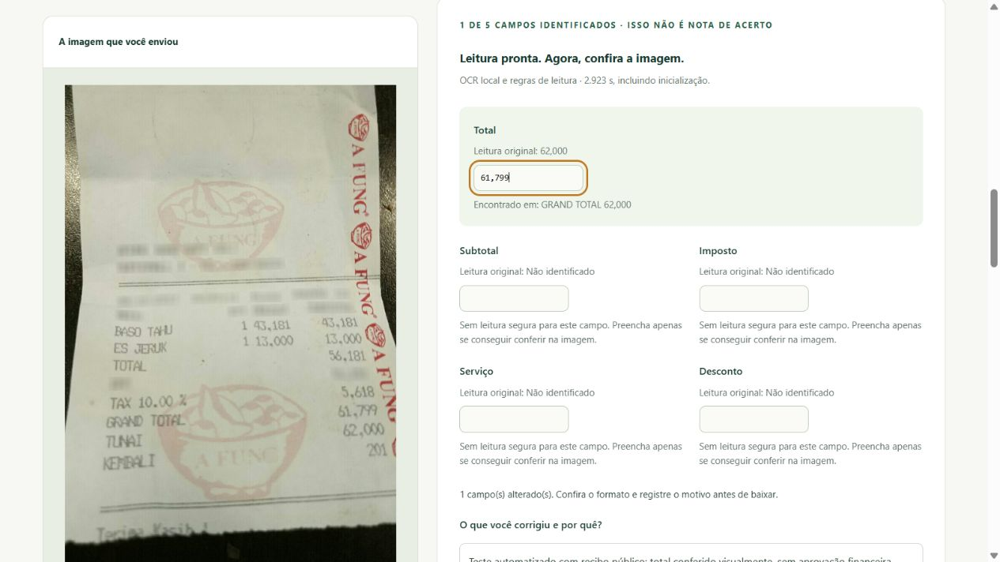

# Verificação: teste com recibo próprio — 30/10/2026

## Entrega

Foi implementada a jornada escolher imagem → acompanhar leitura → conferir campos → exportar resultado. A interface usa PT-BR e inglês, mantém o original separado das correções e explica valores ausentes, formatos inválidos e verificações sem dados suficientes.

O OCR de novas imagens roda em processo separado, sem API externa e sem gravação de imagem ou texto pela aplicação. O fluxo é habilitado com `--uploads`; pode operar junto de `--read-only` sem liberar o banco de revisões. O [guia de uso e limites](../uploads.md) e o [resumo estruturado](uploads-verification.json) complementam este registro.

## Verificações automatizadas

| Verificação | Resultado local |
| --- | --- |
| Testes Python, ambiente com todos os extras | 232 aprovados, incluindo 34 testes novos do upload |
| Testes JavaScript | 27 aprovados, incluindo 6 testes novos do cliente de upload |
| Ruff e formatação Python | Aprovados |
| mypy | Aprovado em 20 módulos de origem |
| Sintaxe JavaScript e Prettier | Aprovados |
| Wheel | Arquivos novos de interface incluídos; 50 recursos públicos com checksum conferidos |
| OpenAPI | Contrato exportado atualizado, com corpo binário PNG/JPEG e operações transitórias |
| Evidências históricas | Imagens, extrações e relatórios de métricas preservados |

Os testes cobrem convenções numéricas explícitas, rótulos em português, valores conflitantes, separação entre pagamento/troco e total, imagem danificada ou com tipo incorreto, dimensões excessivas, redução proporcional, remoção de metadados, OCR vazio e fonte preservada por hash. Também verificam morte do processo em timeout, liberação do limite de concorrência, não herança de chaves de API, limite compartilhado de tentativas e manutenção do bloqueio das revisões na configuração pública.

As requisições do cliente são testadas sem repetição automática, incluindo arquivo inválido antes da rede, timeout, servidor ocupado e resposta fora do contrato. A checagem transitória não considera componentes ausentes como zero e não aceita injeção de itens ou campos além dos limites.

Nenhuma dependência nova foi adicionada: o fluxo usa o extra OCR já existente. O lock não foi alterado nesta etapa. A consulta de vulnerabilidades está registrada na [revisão anterior](security-audit-2026-10-30.md); esta etapa não apresenta aquela consulta como uma nova auditoria de invasão.

## Navegador: documento público real

O exemplo CORD `cord-train-shard0-row0006.png` foi enviado pelo seletor de arquivos e lido por OCR real, sem usar a extração salva como resposta. O formato selecionado foi `idr-grouped`. Em duas observações locais, o tempo informado pelo trabalhador foi 5,094 s e 2,923 s, incluindo inicialização. Esses valores não são benchmark de capacidade nem estimativa para hospedagem.

A leitura devolveu `62,000` no total, ilustrando a necessidade de conferência. O teste automatizado corrigiu o valor para `61,799`, com motivo identificando o teste, preservou o rascunho ao trocar de idioma, conferiu a versão atual e baixou JSON. O arquivo baixado foi aberto e suas estruturas confirmaram original, correção, motivo e eventos. Não foi uma revisão humana de operação real nem avaliação de acurácia.

Um valor inválido (`abc`) foi testado: a interface marcou o campo e explicou o problema. Após corrigir e conferir, o download foi liberado com motivo registrado. Componentes ausentes continuaram sem verificação, sem preenchimento automático de zeros.

## API: imagem sintética em português

Uma imagem gerada exclusivamente para teste, identificada como `TESTE SINTETICO`, continha subtotal `100,00`, desconto `0,00`, imposto `10,00`, serviço `5,00` e total `R$ 115,00`. O OCR real retornou esses cinco campos e a validação conferiu uma igualdade de total; a soma dos itens permaneceu sem verificação, pois itens não são estruturados neste fluxo.

No mesmo servidor com `--read-only --uploads`, o processamento devolveu 200 e a tentativa de escrita em `/api/reviews` devolveu 403. Nenhum banco foi criado. Cabeçalhos de API sem cache e revalidação dos arquivos da interface também foram conferidos. Isso verifica integração do fluxo, sem demonstrar qualidade em recibos brasileiros reais.

## Tela pequena e preservação do projeto

A interface foi inspecionada em viewport 375 × 812. A largura observada do documento foi 360 pixels, sem rolagem horizontal; imagem, campos e explicações permaneceram acessíveis em uma coluna. A configuração temporária do navegador foi restaurada.

Foram usados servidores de QA nas portas 8010 e 8011 e bancos exclusivos de teste. Eles foram encerrados ao concluir. O servidor habitual e suas revisões não foram interrompidos. A imagem enviada pertence ao conjunto público atribuído no projeto; dados particulares e chaves não foram usados no teste. Capturas e relatórios de desenvolvimento não acrescentam resultados aos indicadores do estudo.

## Limites e próxima etapa

A entrega foi verificada localmente. Hospedagem, HTTPS, limites de infraestrutura, RAM/CPU sob carga e execução remota da CI continuam pendentes. O processo separado não é um isolamento do sistema operacional. Os limites são compartilhados por processo, não por pessoa. Não há upload de PDF, inferência Gemini pela web, estruturação de itens ou validação fiscal.

Para reproduzir as verificações, siga o [guia web](../web.md) e execute `npm test` junto dos testes Python com os extras `web` e `ocr`. O fluxo de testes sintéticos pode ser conferido em `tests/test_uploads.py`; os resultados originais do benchmark permanecem na documentação existente.
