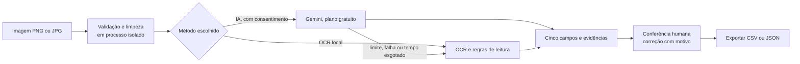
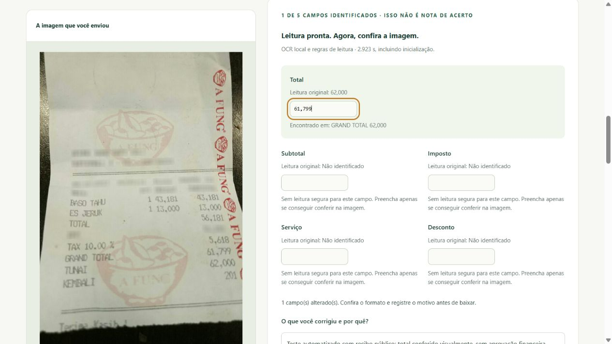

# Testar um recibo próprio

O envio permite testar a leitura de uma imagem nova. Há dois métodos: **IA (Gemini, plano gratuito)**, quando a hospedagem a habilita, e **OCR local**, sempre disponível com `--uploads`. Os dois procuram cinco campos: total, subtotal, imposto, serviço e desconto. A tela mostra a imagem, a leitura original, as linhas usadas como evidência e campos para correção.

Os novos testes não possuem gabarito e não entram nos indicadores do estudo CORD. “Campos identificados” é uma contagem de preenchimento, não uma nota de acerto.

## Dois métodos de leitura




| | IA (Gemini) | OCR local |
| --- | --- | --- |
| Onde a imagem é lida | Enviada ao Google, depois de remover metadados e reduzir o tamanho | Neste servidor, em processo separado |
| Consentimento | Obrigatório; o cabeçalho `X-Provider-Consent: google-gemini-free` é exigido pela API | Aviso de privacidade local |
| No estudo (20 recibos de desenvolvimento) | Total 19/19 | Total 14/19 |
| Tempo típico | Alguns segundos | Cerca de 1 s, mais inicialização |
| Disponibilidade | Limitada por cotas; pode ficar indisponível | Depende só do servidor |

Os números do estudo vêm de uma amostra pequena de desenvolvimento e não garantem o mesmo resultado em recibos brasileiros ou fotos reais.

**Fallback.** Se a leitura por IA não puder ser feita (limite diário, limite por visitante, limite por minuto, serviço ocupado, indisponível, tempo esgotado ou resposta inválida), o OCR local lê o recibo e a tela explica o motivo (`fallback.reason` na API). Falhas de autenticação ou de cota do provedor pausam a IA nesta instância por 1 hora. Imagem inválida continua sendo erro, não fallback.

**Privacidade do plano gratuito.** Nos termos do plano gratuito do Gemini, o Google pode usar o conteúdo enviado para melhorar seus produtos. Por isso a IA só é oferecida com `RECEIPTTRACE_GEMINI_FREE_TIER=confirmed` (decisão de quem hospeda, depois de conferir os termos vigentes) e a pessoa precisa marcar o consentimento a cada leitura. O servidor não grava a imagem nem o resultado.

**Itens e moeda.** A leitura por IA devolve os cinco campos e também as linhas de compra (descrição, quantidade, valor unitário e valor da linha). O OCR local não estrutura itens. A moeda não é presumida.

## Soma dos itens

Muitos recibos, como o cupom fiscal de supermercado (NFC-e), imprimem só o total. Nesses casos os outros quatro campos ficam vazios, e a conferência útil é outra: os valores das linhas devem somar o total. `item_sum.py` faz essa conta com Decimal e devolve `items_check`:

| Estado | Quando ocorre |
| --- | --- |
| `match` | A soma dos itens é igual ao total (ou ao subtotal, se houver subtotal impresso). |
| `mismatch` | A soma difere; a tela mostra os dois valores e a diferença. |
| `unavailable` | Não há como comparar com segurança, com o motivo (`reason`): sem itens, valor de item vazio ou ilegível (com a posição), desconto/imposto/serviço sem subtotal, total ausente ou inválido, itens aninhados ou itens demais (acima de 200). |

Regras de segurança da conta: valor de item ausente nunca vira zero; linhas negativas (descontos impressos como item) são tratadas como ilegíveis, não abatidas em silêncio; a tolerância é zero, porque os valores das linhas já vêm arredondados do papel.

Cada valor de item pode ser corrigido na tabela. A conferência é refeita em `POST /api/uploads/validate` e entra no JSON e no CSV exportados, com os valores antes e depois.

**O que a soma não prova.** Soma igual é um bom sinal, mas não garante que nenhum item foi esquecido ou lido em duplicidade, e dois erros podem se compensar. A leitura de itens **não foi avaliada** no estudo (20 recibos do CORD, sem itens avaliados); só o total e os outros quatro campos têm números publicados. Um recibo com mais de cerca de 60 linhas pode ultrapassar o limite de saída da IA; nesse caso a leitura cai para o OCR local, com o motivo `gemini_invalid_response`.

## Como iniciar

Encerre o servidor anterior com Ctrl+C. Na pasta do projeto:

```powershell
uv sync --locked --extra web --extra ocr
uv run --no-sync receipttrace serve --uploads
```

Abra [http://127.0.0.1:8000/#try](http://127.0.0.1:8000/#try). Se o navegador ainda mostrar a interface anterior, recarregue a página. Sem `--uploads`, os exemplos continuam disponíveis e a tela explica que o envio está desativado.

Para habilitar o teste temporário em uma instância pública, mantenha as revisões do banco bloqueadas:

```powershell
uv run --no-sync receipttrace serve --read-only --uploads --host 0.0.0.0
```

Para oferecer também a leitura por IA, defina as variáveis abaixo (a chave nunca vai para o repositório nem para a conversa; veja [implantação](deploy.md)):

| Variável | Função | Padrão |
| --- | --- | --- |
| `RECEIPTTRACE_UPLOAD_GEMINI` | `1` liga a opção de IA | desligado |
| `RECEIPTTRACE_GEMINI_FREE_TIER` | `confirmed`: o responsável confirma que a chave é do plano gratuito e leu os termos | ausente |
| `GEMINI_API_KEY` | Chave do Google AI Studio | ausente |
| `RECEIPTTRACE_GEMINI_MODEL` | Modelo, dentre os permitidos em `llm_config` | `gemini-3.5-flash-lite` |
| `RECEIPTTRACE_GEMINI_DAILY_LIMIT` | Leituras por IA por dia, no servidor (1–500) | 40 |
| `RECEIPTTRACE_GEMINI_CLIENT_DAILY_LIMIT` | Leituras por IA por dia, por visitante (1–50) | 5 |
| `RECEIPTTRACE_GEMINI_PER_MINUTE` | Leituras por IA por minuto (1–15) | 6 |
| `RECEIPTTRACE_GEMINI_PAUSE_SECONDS` | Pausa após erro de cota/autenticação | 3600 |
| `RECEIPTTRACE_PROXY_HOPS` | Quantos proxies confiáveis precedem o app (0–5), para identificar o visitante | 0 |

Sem as três primeiras variáveis, a opção de IA não aparece e o comportamento é o do OCR local.

Esse comando não publica o projeto por conta própria. A hospedagem ainda precisa ser configurada e testada com HTTPS, limites de memória/CPU e tráfego. O OCR local não tem cobrança por chamada; a IA usa o plano gratuito do Gemini, com cotas e termos próprios.

## Jornada da pessoa

1. Escolher uma imagem PNG ou JPG, sem dados pessoais ou sensíveis.
2. Escolher como os números aparecem no documento. O idioma da página não altera a interpretação dos valores.
3. Escolher o método (IA ou OCR local), confirmar o aviso correspondente e selecionar “Ler meu recibo”. Trocar de método limpa a confirmação. A tela mostra o tempo decorrido durante o recebimento e a leitura, sem porcentagens fictícias.
4. Conferir a imagem e os campos. Valores ausentes ou conflitantes ficam vazios; linhas reconhecidas podem ser consultadas.
5. Corrigir os valores necessários e registrar o motivo. Selecionar “Conferir formato e cálculos” para avaliar a versão atual. O resultado mostra problemas de formato e divergências, além do que não pôde ser verificado.
6. Baixar o JSON com a extração original, a versão atual, as alterações antes/depois, o motivo e os horários desta sessão. Usar “Limpar este teste” para remover o conteúdo da interface.

PT-BR e inglês preservam o arquivo selecionado, as correções e o motivo. O navegador avisa ao sair quando há correções ainda não exportadas. O registro desta aba não autentica quem conferiu e não é armazenado no banco de revisões dos exemplos.

## Formatos de números

| Seleção | Exemplos | Política técnica |
| --- | --- | --- |
| Vírgula decimal | `12,50`, `1.234,56`, `R$ 1.234,56` | `brl-grouped` |
| Ponto decimal | `12.50`, `1,234.56`, `$ 1,234.56` | `usd-grouped` |
| Sem centavos | `61,799` ou `61.799`, ambos representando `61799` | `idr-grouped` |

São convenções numéricas explícitas; não determinam a moeda do documento. As regras de leitura ao vivo são `upload-rules-1`, separadas das regras históricas `ocr-rules-1`. Os valores mantêm sua escrita original e a normalização usa Decimal.

## Proteções e retenção

- Corpo da imagem: até 8 MiB; PNG ou JPEG confirmado pelo decodificador, não apenas pela extensão. Imagens animadas ou com múltiplos quadros são recusadas.
- Resolução: até 12 milhões de pixels, até 12.000 pixels por lado, mínimo de 32 pixels por lado. As dimensões são verificadas antes da leitura completa dos pixels.
- Preparação: orientação EXIF aplicada, metadados removidos e redução proporcional para até 2.400 pixels por lado antes do OCR. A tela informa quando houve redução.
- Recebimento: até 10 segundos; conferência transitória de campos: até 256 KiB, campos limitados a 64 caracteres, sem edição ou injeção de itens.
- Execução: processo separado, uma imagem por vez e até 10 tentativas por minuto **por processo do servidor**, compartilhadas entre visitantes. O OCR é interrompido após 60 segundos. A interface aguarda até 70 segundos e não repete automaticamente a requisição.
- O processo de OCR recebe somente as variáveis de ambiente necessárias; chaves Gemini/OpenAI não são herdadas. Na leitura por IA, o mesmo processo apenas sanitiza a imagem e a devolve em JPEG; a chamada ao Gemini é feita pelo servidor, que é o único com a chave.
- Cotas da IA (por dia, por visitante, por minuto, simultaneidade) ficam **em memória**: zeram quando o servidor reinicia ou volta de suspensão. O visitante é contado por um hash com sal por processo do endereço de rede; atrás de proxy, `RECEIPTTRACE_PROXY_HOPS` precisa estar correto, senão todos parecem um só visitante ou o cabeçalho pode ser forjado.
- A aplicação não grava imagem nem texto recebido no sistema de arquivos, banco ou logs. O resultado é devolvido à mesma requisição e permanece na memória da aba. O JSON só é gravado no computador quando a pessoa solicita o download.
- A imagem é identificada por SHA-256. O nome informado pelo visitante não vira caminho no servidor. Não há endpoint de consulta de imagens ou resultados enviados por outras pessoas.

O processo separado não é um isolamento de segurança do sistema operacional nem um limite rígido de RAM. O limite de concorrência é local ao processo e não é uma cota por pessoa nem defesa contra DDoS. O encerramento do navegador pode deixar o OCR terminando no servidor até o limite de tempo; não há tarefa persistente nem consulta posterior. A hospedagem deve impedir gravação/captura de corpos pelo proxy e configurar seus próprios limites e logs. Memória virtual, navegador e infraestrutura não estão cobertos por uma garantia de apagamento seguro.

## O que o resultado não comprova

O OCR pode errar letras e números. As regras reconhecem rótulos comuns em português, inglês e os rótulos indonésios usados no estudo; isso não comprova suporte geral a esses idiomas. Modelos e regras ainda não foram avaliados em uma amostra independente de recibos brasileiros.

No OCR local, itens não são estruturados e a soma dos itens não é conferida; na leitura por IA, veja a seção “Soma dos itens”. Para verificar `subtotal − desconto + imposto + serviço = total`, todos os cinco componentes precisam estar explícitos e válidos. Campo ausente não é convertido em zero. Uma igualdade aritmética ou uma correção feita no navegador não aprova pagamento, documento fiscal ou autenticidade.

## API e responsabilidades

| Rota | Uso |
| --- | --- |
| `GET /api/uploads/capabilities` | Disponibilidade e limites; não inicializa o motor OCR. |
| `POST /api/uploads?policy=brl-grouped&engine=ocr\|gemini` | Corpo binário PNG/JPEG; `engine=gemini` exige o cabeçalho de consentimento (400 `consent_required` sem ele). Devolve leitura, evidências, validação e, se houve fallback, `fallback.reason`. |
| `POST /api/uploads/validate` | JSON transitório com os cinco campos, até 200 itens e a política; reavalia sem salvar e devolve também `items_check`. |

`upload_worker.py` verifica e prepara a imagem e executa o OCR. `upload_rules.py` seleciona campos de forma conservadora. `uploads.py` controla processo, concorrência, tempo e a escolha do método com fallback. `upload_gemini.py` contém o leitor Gemini, as cotas e o mapeamento de erros para motivos de fallback. `web_boundary.py` aplica origem, formato e tamanho. `upload.js` apresenta a jornada, correções e exportação; `upload-client.js` contém o contrato de envio e as diferenças entre original e versão atual.

O [contrato OpenAPI](contracts/web-openapi.json), os testes `test_uploads.py` e `upload-client.test.mjs` e o [relatório desta entrega](quality.md) permitem conferir a implementação.

## Exemplo pronto e exportação

“Usar recibo de exemplo” carrega uma leitura pública salva, identificada na tela, sem enviar arquivo nem executar OCR. O caso continua disponível com uploads desativados. A conferência transitória dos cinco campos não acessa o banco local e fica disponível para esse fluxo.

CSV resume campo, original, valor revisado, motivo e hash da imagem; células potencialmente interpretadas como fórmulas são neutralizadas. JSON mantém a leitura e o registro completo. A opção de consultar disponibilidade novamente recupera uma falha de conexão sem exigir que a pessoa feche a página.


